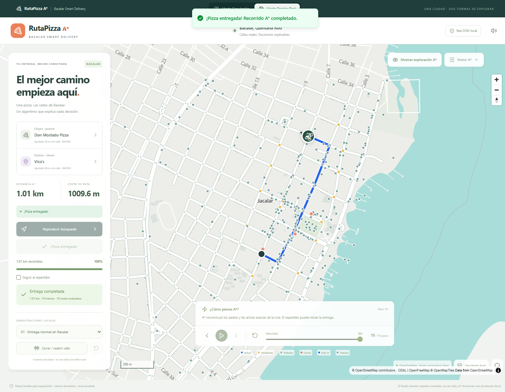

# RutaPizza A* — Bacalar Smart Delivery

Dos modalidades comparten el mismo núcleo A*: **Modo Simulación**, que conserva la ciudad SVG, y **Modo Bacalar Real**, con MapLibre GL JS y una red vial regional de Bacalar, Quintana Roo. Dentro del mapa real se puede elegir la red ampliada o la demostración central anterior. La aplicación es educativa; los cierres, clientes y entregas son simulados.

## Ampliación actual: UPB, Cenote Azul y regreso

El mapa real abre por defecto **Bacalar ampliado**: 883 nodos de cálculo, 2,355 aristas dirigidas, 1,324 tramos físicos y 169.27 km de vías OSM en una envolvente aproximada de 82 km². No se afirma que OSM tenga todas las calles ni que todas tengan sentidos o accesos verificados. Se mantienen intactos el escenario central y sus datos, además del SVG.

Incluye A* con heap binario, cálculo en Web Worker, traza compacta reversible, índice espacial, perfiles de distancia/tiempo estimado/riesgo conocido, reportes locales persistentes y flujo **pizzería → destino → pizzería**. El regreso se calcula desde cero sobre el grafo dirigido. Los cierres durante la entrega detienen la moto en su posición vial y preparan un cálculo nuevo; la continuación requiere una orden explícita.

| Destino (perfil más corto)                          |        Ida | Regreso independiente |
| --------------------------------------------------- | ---------: | --------------------: |
| UPB, terminal de vía de servicio cartografiada      | 4,178.81 m |            3,922.68 m |
| Cenote Azul, llegada exterior por Boulevard Costera | 4,289.31 m |            4,098.98 m |

La UPB usa el acceso vial OSM dentro del polígono universitario, sin certificar la entrada actual. El Cenote Azul termina en la calle junto a una conexión peatonal: no se inventa acceso motorizado al agua ni se recorren escaleras.

**Resultados actuales: 62 pruebas aprobadas, incluidas las 32 anteriores.** Se comprobaron en Chrome los viajes completos a ambos destinos, las geometrías OSM, los reportes, la ruta verde de regreso y el recálculo sin salto de posición.

Documentación técnica, fuentes, fórmulas, cobertura y limitaciones: [docs/REGIONAL.md](docs/REGIONAL.md). Resultados numéricos completos y trazables: [public/data/regional-validation.json](public/data/regional-validation.json).

```powershell
npm.cmd run dev
# Abre la URL de Vite y selecciona Modo Bacalar Real → Bacalar ampliado.
npm.cmd test
npm.cmd run build
node scripts/browser-check.mjs --regional
# Generación local, sin descargas:
npm.cmd run data:build
# Actualización manual opcional; consulta Overpass una sola vez:
npm.cmd run data:update
# O importar un extracto OSM local legítimo:
npm.cmd run data:update -- --input ruta/al/extracto.json
```

Las secciones siguientes documentan también el escenario central anterior. Sus cifras de 289 nodos y 801 aristas corresponden solo a ese conjunto de demostración.



## Abrir Bacalar

```powershell
npm.cmd install
npm.cmd run dev
```

Abre la dirección indicada por Vite (normalmente http://localhost:5173). Selecciona **Modo Bacalar Real**, o abre http://localhost:5173/#bacalar. El modo SVG sigue disponible y conserva su estado al alternar. Bacalar se carga en un bloque separado, incluido el worker de MapLibre, para no cargar el motor cartográfico al abrir únicamente el SVG.

## Datos del escenario central anterior

- Extracto: `public/data/bacalar-osm.json`, respuesta OSM con 3,907 elementos, obtenida el **27 de octubre de 2026** mediante una única consulta pequeña a la Map API oficial. Las instancias Overpass consultadas no estaban disponibles durante la preparación; no se fabricaron calles ni comercios como sustituto.
- Caja: sur 18.669, oeste −88.402, norte 18.685, este −88.384. Se incluyen exclusivamente conexiones transitables dentro de este recorte. Una ruta inaccesible aquí podría tener una alternativa fuera del área.
- Procedencia verificable, URL original y fecha UTC: `public/data/provenance.json`. El archivo crudo se conserva para poder reconstruir el grafo y comprobar las geometrías.
- Resultado de conversión: **289 nodos, 801 aristas dirigidas, 464 tramos físicos y 332 puntos de interés**. Son datos de la instantánea, no un catálogo completo ni garantía de apertura actual de negocios. Los POI de áreas usan un punto representativo de sus nodos, que no identifica necesariamente una entrada.
- El grafo respeta nodos OSM compartidos, límites del recorte, `oneway`, `oneway=-1`, rotondas y restricciones simples de acceso a motocicletas. Cruces sin un nodo OSM compartido no se conectan. Los puntos intermedios de las calles se conservan en sus geometrías aunque se compriman como vértices del grafo.
- Este modelo no interpreta relaciones de prohibición de giro, restricciones condicionales por horario, velocidades, tráfico ni cambios posteriores a la instantánea. No es un sistema de navegación vial para uso en carretera.

Los datos y derivados cartográficos se distribuyen bajo **ODbL 1.0**, con atribución visible a **© OpenStreetMap contributors**. Consulta [licencia y atribución OSM](https://www.openstreetmap.org/copyright) y [licencia ODbL](https://opendatacommons.org/licenses/odbl/1-0/). La licencia de datos no cambia la licencia de las bibliotecas. Consulta también `public/data/LICENSE.md`.

## Fondo cartográfico y conexión

**En línea:** MapLibre usa el estilo Positron y las teselas vectoriales de **OpenFreeMap**, con colores personalizados de agua turquesa, parques verdes, edificios grises y calles claras. Se conservan las atribuciones del proveedor y OpenMapTiles. No se utilizan llaves ni un servicio de instrucciones de ruta. La vista se limita al entorno de Bacalar; no se descargan áreas masivamente ni se implementa precarga de teselas. Referencias: [guía oficial](https://openfreemap.org/quick_start/) y [condiciones del proveedor](https://openfreemap.org/tos/).

**Fondo local:** el botón **Usar fondo local** detiene la modalidad de fondo remoto y dibuja calles, edificios y parques del extracto OSM mediante GeoJSON. Es un fondo simplificado, no una copia completa del mapa remoto; por ejemplo, no contiene una geometría inventada de la laguna. La búsqueda, los comercios de la instantánea y las demostraciones funcionan sin internet mientras la aplicación se sirva localmente y el navegador tenga WebGL. Si falla el proveedor, se conserva la red local. Sin WebGL se informa el problema y sigue disponible el modo SVG.

No se afirma que las teselas, fuentes o etiquetas del proveedor remoto funcionen sin conexión. La aplicación no incorpora un service worker para instalar el sitio completo sin servidor HTTP.

## A* compartido y exactitud de la ruta

`src/astar.ts` es el núcleo puro compartido: lista abierta y cerrada, selección determinista, relajación de costos, padres, aristas de procedencia y snapshots independientes. `src/algorithm.ts` adapta el tablero original a ese núcleo y mantiene sus exportaciones y pruebas.

En Bacalar, `g(n)` es la suma de longitudes de los tramos recorridos en **metros**; cada tramo suma la distancia Haversine de todos los pares consecutivos de su geometría, con radio terrestre 6,371,008.8 m. `h(n)` es Haversine directa desde el nodo hasta el destino. Esta heurística es admisible y consistente por la desigualdad triangular; no se usa Manhattan sobre latitudes y longitudes. `f(n) = g(n) + h(n)`. El desempate usa menor h y luego identificador estable.

El núcleo reconstruye **identificadores de aristas dirigidas**, no solo nodos: así se conserva la elección correcta incluso si existen calles paralelas entre los mismos extremos. `routeFeature` comprueba la cadena de extremos y concatena exactamente la geometría de esas aristas. Las capas MapLibre, la exportación GeoJSON y la motocicleta utilizan esa misma línea. La animación interpola la distancia acumulada por sus segmentos, con rumbo geográfico, pausa, reanudación y seguimiento de cámara. El costo no es una tarifa monetaria.

**No se llama a Google Directions, OSRM ni otro motor externo de rutas.** El fondo cartográfico y Overpass solo suministran datos. La optimalidad se refiere al grafo local, sus sentidos y los cierres seleccionados.

## Controles de Bacalar

1. Selecciona una pizzería del catálogo o pulsa la tarjeta **Origen** y haz clic en el mapa. Haz lo mismo con **Destino**, o usa **Ir aquí** en la tarjeta de un comercio. Los puntos se ajustan al nodo transitable más cercano, hasta 200 m; se informa la distancia y se dibuja el ajuste con una línea discontinua. Un punto demasiado lejano se rechaza.
2. **Calcular ruta con A*** o **Reproducir** muestra las expansiones a la velocidad elegida. **Siguiente** y **Anterior** restauran listas, costos y decisiones reales. El repartidor espera en el origen durante la búsqueda.
3. **Motor A*** abre el panel de costos en metros, listas, iteraciones, tabla y conexiones examinadas. **Mostrar exploración A*** alterna entre la vista educativa y una vista de navegación más limpia. La ruta final es azul intenso; actual azul, abiertos amarillos, visitados grises y cierres rojos.
4. **Cerrar / reabrir calle** activa el clic sobre tramos. Un cierre se aplica al identificador físico e impide ambos sentidos existentes. Cada edición invalida la búsqueda y entrega anteriores. **Limpiar cierres** reabre los tramos. La ruta anterior se conserva en gris discontinuo para comparar con un nuevo cálculo.
5. Después de encontrar una ruta, **Iniciar entrega**, **Pausar entrega** y **Reanudar entrega** controlan la motocicleta. El progreso y costo recorrido se calculan sobre esa ruta. **Seguir al repartidor** mueve la cámara; **Velocidad** regula tanto las expansiones como la velocidad simulada de entrega (12 m/s × multiplicador; no es una estimación de tiempo real).
6. La llegada muestra un resumen y una animación de éxito; el sonido Web Audio se habilita mediante clic y puede silenciarse. El panel permite consultar la secuencia de nodos y _*Exportar ruta A* GeoJSON_*.
7. Busca negocios, nombres de calles y lugares dentro del catálogo local. **Actualizar comercios con Overpass** hace una consulta delimitada; no modifica el grafo de las demostraciones. No hay geocodificación mundial ni consulta con cada pulsación del buscador.
8. **Agregar punto personalizado** solicita un nombre y un clic en el mapa. Se guarda solo en localStorage de este navegador; puede usarse como origen/destino y eliminarse desde su tarjeta. Nunca se escribe en OpenStreetMap.

Los controles propios del mapa permiten zoom, desplazamiento, rotación y restablecer norte. **Centrar Bacalar** restablece la vista. En móvil el mapa se sitúa arriba y los paneles se disponen debajo.

## Tres demostraciones reproducibles

Los extremos se eligen de la instantánea: **Don Mostado Pizza** (ajuste de 30.31 m al nodo OSM 3744961664) y **Vico’s** (27.89 m al nodo 3744961933). Son nombres de registros OSM, sin afirmación de disponibilidad comercial actual.

- **01 · Entrega normal:** **1,009.590 m**, 10 aristas y 19 expansiones en la instantánea incluida.
- **02 · Calle cerrada:** cierra determinísticamente un tramo de la ruta normal cuya eliminación permite otra ruta. La ruta previa aparece discontinua y el nuevo camino excluye el tramo cerrado.
- **03 · Destino inaccesible:** cierra todos los tramos con acceso al nodo destino. La búsqueda agota la lista abierta, no dibuja una ruta y no habilita entrega.

Elegir una demostración restaura estos extremos; los cierres manuales siguen siendo libres. No hay aleatoriedad ni llamadas externas para preparar los escenarios de Bacalar.

## Overpass y uso responsable

La aplicación no consulta Overpass automáticamente al cargar, buscar, mover o acercar el mapa. Solo el botón de actualización realiza un POST acotado a `overpass.private.coffee`, con timeout de 25 s, caché de **24 horas**, una sola consulta simultánea y enfriamiento de **60 segundos** tras fallos. Se conserva el catálogo local si hay error, resultados parciales o almacenamiento no disponible. La caché no es un botón para forzar consultas repetidas.

`node scripts/fetch-bacalar.mjs` es una herramienta manual opcional para renovar el extracto por Overpass. No forma parte del arranque, las pruebas ni la compilación. Una nueva instantánea debe revisarse y volver a validarse; puede cambiar nombres, conectividad y costos de las demostraciones. Referencias: [uso compartido de Overpass](https://dev.overpass-api.de/overpass-doc/en/preface/commons.html) e [instancias públicas](https://wiki.openstreetmap.org/wiki/Overpass_API#Public_Overpass_API_instances). Para despliegues con mucho público se necesitaría otra infraestructura; este proyecto usa datos locales por defecto.

## Estructura nueva

```text
src/astar.ts                  Núcleo A* de ambos modos
src/algorithm.ts              Adaptador del SVG, escenarios originales
src/ModeApp.tsx               Selector de modalidades
src/geo/graph.ts              OSM → grafo, Haversine, snap, GeoJSON
src/geo/demo.ts               Extremos reproducibles de Bacalar
src/geo/places.ts             Overpass, caché, POI personalizados
src/geo/BacalarApp.tsx        Estado y controles de navegación
src/geo/BacalarMap.tsx        MapLibre, capas GeoJSON y marcador
src/geo/mapStyle.ts           Fondo local y personalización vectorial
src/geo/useDelivery.ts        Entrega por distancia, pausa y reanudación
public/data/                  Extracto crudo, procedencia y licencia
```

## Verificación de ambos modos

```powershell
npm.cmd test
npm.cmd run build
# Con Vite abierto y Chrome instalado:
node scripts/browser-check.mjs
node scripts/browser-check.mjs --bacalar
# Comprobación opcional del proveedor remoto (requiere internet):
node scripts/browser-check.mjs --online
# Servir la compilación de producción:
npm.cmd run preview
```

`CHROME_PATH` permite elegir otro ejecutable Chrome; `TEST_URL` permite cambiar el puerto de las pruebas de navegador. Las capturas se guardan en la carpeta temporal del sistema.

Las **32 pruebas unitarias** conservan las 9 originales e incluyen conversión a grafo, intersecciones compartidas, sentido de circulación, geometrías curvas, accesos, Haversine, consistencia/admisibilidad de la heurística, comparación contra Dijkstra independiente, cierres, tres demostraciones, ajuste a nodos, reconstrucción GeoJSON, muestreo de animación, restauración de snapshots, mejoras de costos y caché/fallos de Overpass.

La comprobación de Chrome verifica el renderizado de capas WebGL, costos y avance/retroceso sincronizados, ruta azul comparada coordenada por coordenada contra los nodos de las vías OSM originales, entrega con pausa/reanudación, clic en un tramo, comparación de rutas, destino inaccesible con la red del navegador desconectada, búsqueda de POI, cambio entre modos, consola y ancho móvil de 390 px. El sonido está implementado; una prueba de navegador automatizada no comprueba su audibilidad física.

También se verificaron creación, uso y eliminación de puntos personalizados, seguimiento de cámara y fallo de Overpass sin perder el catálogo local. La prueba opcional `--online` comprobó la capa de agua real de las teselas OpenFreeMap, el color turquesa, el dibujo de la ruta A* y una entrega completa sobre la compilación de producción. Los resultados concretos están en [docs/VALIDACION.md](docs/VALIDACION.md).

---

## Documentación del simulador SVG conservado

Aplicación universitaria interactiva para explicar A* a través de una entrega de pizza. La búsqueda y el movimiento del repartidor son procesos independientes: explorar una intersección no mueve el vehículo.

## Ejecutar

Requiere Node.js 20.19+ o 22.12+ y npm. La instalación inicial descarga dependencias; la aplicación no utiliza servicios externos, API keys ni fuentes remotas.

```sh
npm install
npm run dev
```

Abre la dirección indicada por Vite (normalmente http://localhost:5173). En PowerShell con scripts restringidos usa `npm.cmd` en lugar de `npm`.

```sh
npm test
npm run build
```

El resultado de producción está en `dist/` y debe servirse por HTTP. Después de instalar, desarrollo, pruebas y compilación funcionan sin internet.

## Objetivo y tecnologías

Visualizar decisiones reproducibles, explicar costos reales y comparar alternativas. React, TypeScript estricto, Vite, Tailwind CSS, CSS personalizado, Motion, Lucide React, Sonner, SVG, Web Audio API y Vitest. Estado local de React: no se necesita un almacén adicional. Tipografía del sistema para funcionar sin conexión.

## Modelo y algoritmo

La ciudad es un grafo ortogonal de 8 × 8 intersecciones. Las calles conectan vecinos horizontales y verticales; cada arista cuesta 1. Un obstáculo cierra una intersección vial y todas sus conexiones. El inicio y el destino están protegidos.

`src/algorithm.ts` contiene exclusivamente lógica de dominio, sin dependencias de React. A* mantiene lista abierta, lista cerrada, costos y padres. Cada iteración toma el nodo con menor `f(n) = g(n) + h(n)`, donde g es el costo recorrido y h la distancia Manhattan al destino: `|x − destino.x| + |y − destino.y|`. En empates elige menor h y luego identificador en orden lexicográfico. Con costos uniformes y esta heurística consistente, el primer cierre de un nodo fija su costo óptimo. Las alternativas abiertas se actualizan si se descubre un g menor.

Cada selección produce una instantánea independiente de listas, registros, decisiones y padres. El historial permite restaurar exactamente cualquier paso sin modificar el estado anterior. Encontrar el destino reconstruye sus padres; agotar la lista abierta declara destino inaccesible. La rutina de relajación contempla mejoras aunque no todos los escenarios necesitan actualizaciones.

## Colores

| Color    | Significado          |
| -------- | -------------------- |
| Azul     | Nodo actual          |
| Amarillo | Lista abierta        |
| Gris     | Nodo evaluado        |
| Rojo     | Intersección cerrada |
| Verde    | Camino óptimo        |
| Morado   | Destino              |

Las líneas grises discontinuas muestran relaciones de padres conocidas; los círculos discontinuos resaltan vecinos de la iteración actual. Los descartes se explican en el panel de decisiones y no representan un retroceso físico de la motocicleta.

## Controles

- **Iniciar búsqueda / Reproducir automáticamente:** avanza el historial con el intervalo seleccionado.
- **Siguiente paso / Paso anterior:** pausa y restaura la instantánea siguiente o anterior, incluyendo costos y decisiones. No mueve el repartidor.
- **Pausar:** detiene la reproducción automática.
- **Reiniciar:** regresa al estado inicial conservando el mapa.
- **Escenario, semilla y Generar:** construye una ciudad reproducible y reinicia búsqueda y entrega. Cambia la semilla para obtener otra ciudad.
- **Agregar obstáculos:** activa edición; clic o Enter sobre una intersección coloca o retira un bloqueo. Cada cambio invalida la búsqueda anterior.
- **Limpiar obstáculos:** abre todas las intersecciones y reinicia.
- **Probar destino inaccesible:** carga el escenario bloqueado.
- **Zoom +/−, centrar y arrastrar:** explora el SVG, también con controles táctiles.
- **Mostrar ruta óptima:** muestra u oculta el recorrido al terminar la búsqueda.
- **Iniciar entrega:** disponible solo cuando hay una ruta; desplaza la bicicleta por sus aristas, orienta el icono y actualiza progreso, posición y costo. La velocidad también regula la entrega.
- **Sonido:** activa o silencia el acorde final. El contexto de audio se inicia mediante interacción explícita del usuario.

## Escenarios y ejemplo

1. **Entrega sencilla:** baja densidad de cierres y corredor garantizado.
2. **Tráfico y calles cerradas:** mayor densidad y corredor garantizado.
3. **Ciudad bloqueada:** bloquea todos los vecinos del destino y garantiza que no haya ruta.

Ejemplo: usa escenario 1, semilla 42. Avanza una iteración: g del origen es 0, h es 12 y f es 12. Observa vecinos y sus costos; reproduce hasta encontrar la ruta. El camino reservado garantiza un costo óptimo de 12 movimientos en los escenarios 1 y 2. Inicia la entrega para ver el recorrido y el resumen. Después prueba el escenario 3: la búsqueda agota sus alternativas y no habilita una entrega.

## Pruebas

`npm test` verifica distancia mínima, obstáculos, desvíos, inaccesibilidad, inicio igual a destino, relajación y mejora de costos, padres y reconstrucción, desempate, restauración del historial y límites del cursor. También compara los tres escenarios en 100 semillas contra una búsqueda BFS independiente (300 ciudades). `npm run build` comprueba los tipos y genera la aplicación.

Los tests de dominio no sustituyen una inspección visual en navegador ni validan la salida de audio del dispositivo.

Para repetir la comprobación de integración, deja `npm run dev` abierto y ejecuta `node scripts/browser-check.mjs` en otra terminal. Requiere Chrome local en Windows (o configurar `CHROME_PATH`). Comprueba edición de obstáculos, restauración de estados, entrega completa, destino inaccesible, ausencia de desbordamiento a 390 px y errores de consola; guarda capturas de escritorio y móvil en la carpeta temporal del sistema. La llegada se confirma al terminar la animación de la última calle; cada segmento comienza después de completar el anterior.
